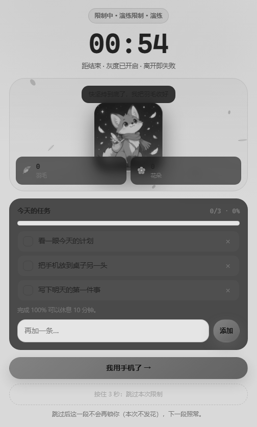
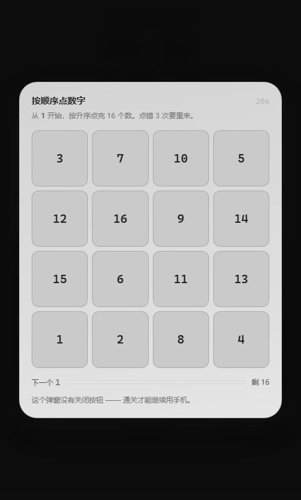
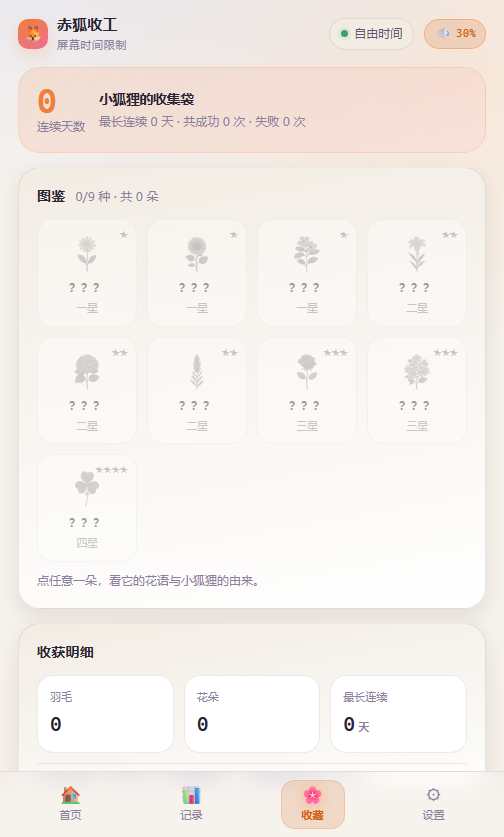
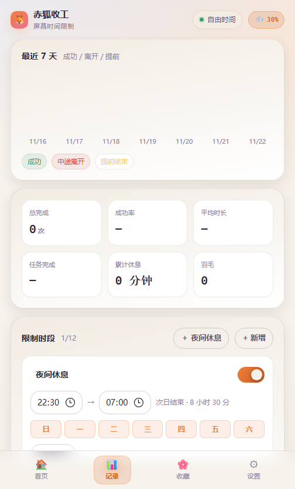
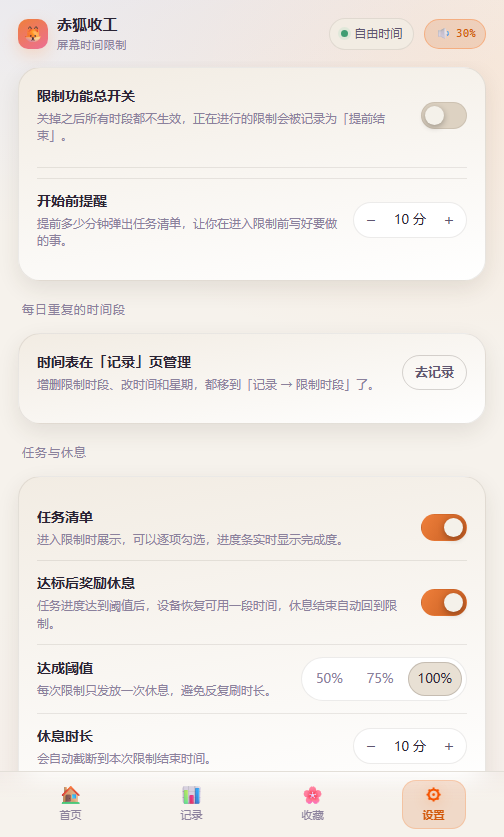

# 🦊 赤狐收工 · 屏幕时间限制管理器

> 到点自动锁屏变灰，得先写下今晚要做的事并一件件勾完；中途切走小狐狸会哭，坚持到底它叼一朵花回来。

**▶ 在线试玩：<https://moom9119.github.io/chihu-shougong/demo.html>**
（静音单文件版，打开即用；根目录 `index.html` 是多文件开发版，需要本地服务）

**零依赖、零构建、零后端的纯前端项目**：原生 ES Modules 分三层，用一个手写的纯函数状态机驱动全部业务；
数据只存在本机 `localStorage`，不上传、不联网、不要账号。

[功能](#功能) · [技术方案](#技术方案) · [目录](#目录) · [怎么跑](#怎么跑) · [测试](#测试)

---

## 这是什么

解决「知道该放下手机，但每次都多刷一会儿」的问题。它不靠每天重新下决心，而是把边界**预先设成时段**：

| 环节 | 做法 |
|---|---|
| 边界 | 每日重复的限制时段（如 22:30–07:00），支持跨午夜、按星期、多段合并 |
| 进入 | 提前 10 分钟提醒填任务 → 到点自动全屏锁定 + 灰度 |
| 停留 | 锁屏给出的不是「禁止」，而是一张你写的任务清单 + 进度条 |
| 摩擦 | 退出要按住 3 秒；解锁要按升序点完数字矩阵 |
| 反馈 | 切走 → 小狐狸哭着失败；坚持到底 → 收一朵花，进图鉴、记连续天数 |
| 例外 | 重要联系人发来消息 → 响铃 + 暂停倒计时，恢复时顺延 |


---

## 界面

| 锁定中 | 数字矩阵 | 结算收花 |
|---|---|---|
|  |  |  |

| 收藏册 | 记录与统计 | 首次引导 |
|---|---|---|
|  |  |  |

---

## 功能

<details>
<summary><b>限制时段</b>（9 条）</summary>

- 每日重复时段，一次设好每天自动生效
- 跨午夜：开始晚于结束即视为次日结束（22:30 → 07:00 是一段）
- 按星期生效，按「开始那一天」计算
- 最多 12 段，重叠自动合并成一次限制
- 一键补齐「夜间休息」22:30–07:00
- 改名 / 改时间即时生效；删除为两步确认
- 每段独立启用开关；关闭后卡片变淡
- 试跑 60 秒：不计统计、不发花、不落盘
</details>

<details>
<summary><b>预警与任务</b>（7 条）</summary>

- 提前 0–60 分钟（默认 10）预警页，可折叠成倒计时条
- 手写任务或一键套模板，可逐条删除
- 逐项勾选 + 进度条实时同步
- 达标发休息：阈值 50/75/100%（默认 100%）
- 休息时长 1–180 分钟（默认 10），自动截断到时段结束
- 休息每次限制只发一次
- 休息结束自动回锁，休息期间离开不算失败
</details>

<details>
<summary><b>锁定 / 矩阵 / 灰度</b>（7 条）</summary>

- 全屏锁定层，底部导航被拦
- 自动灰度（强度 0–100%）+ 额外压暗 0–60%
- 数字矩阵：3×3~6×6、最大数字 9–144、限时、容错、冷却全可调
- 触发时机：点「我用手机了」或从后台切回
- 点错只计数，不判负
- 长按 3 秒（可调）提前结束，不发花
- 退出后本轮不再锁；刷新能恢复现场
</details>

<details>
<summary><b>狐狸与奖励</b>（7 条）</summary>

- Canvas 粒子收集，DPR 自适应
- 离开超过容忍时长（默认 3 秒）→ 哭泣立绘 + 震动
- 三种结算：坚持到底 / 中途离开 / 提前结束
- 9 种花 × 4 档稀有度，加权随机
- 每朵花有花语与「由来」，点开看插画与首次获得时间
- 羽毛、花朵总数、成功失败、连续天数、最佳连续
- 成功必得一朵花，首次获得标记「新物种」
</details>

<details>
<summary><b>重要联系人</b>（8 条）</summary>

- 微信 / QQ / 钉钉，最多 50 人；名单为空时接受所有消息
- 响铃 1–10 次 + 通知 + 震动
- 自动暂停倒计时，同时解除灰度
- 恢复时按暂停时长顺延结束时间
- 同一联系人冷却 5–600 秒
- 宿主集成接口：`FoxLock.notify({app, contact})` 或 `postMessage`
- 设置页有「测试：响一次铃」
</details>

<details>
<summary><b>记录、统计与设置</b>（12 条）</summary>

- 近 7 天柱状图（成功 / 离开 / 提前结束）
- 六张统计卡：时长、成功次数、成功率、平均时长、任务完成率、休息、羽毛
- 明细按天分组，默认只展开近三天
- 清空记录（两步确认，不动收藏册）
- 限制总开关 + 各功能独立开关
- 参数全可调：阈值、休息、灰度、矩阵五参数、响铃、冷却、容忍、长按
- 主题（跟随系统 / 深 / 浅）、减少动效
- 通知权限申请；恢复默认（两步确认）
- 背景音乐三档（20/30/50%）+ 关，只在四个页面播放
- 提示音为 Web Audio 现场合成
</details>

---

## 技术方案

**没有任何框架与构建工具**：手写 ES Modules + Canvas 2D + Web Audio + CSS filter。

### 三层单向依赖

```
ui/        ← 只读 state，产出 HTML 字符串
  ↑
platform/  ← 浏览器能力：灰度 / 在场检测 / 通知 / WakeLock / 音效 / 背景音乐
  ↑
core/      ← 纯逻辑：状态机 / 时间表 / 任务 / 矩阵 / 收集 / 持久化（零 DOM）
  ↑
src/main.js = 唯一装配层
```

`core/` 不碰任何浏览器 API，所以 118 项逻辑测试能在 Node 里跑，不需要浏览器；
状态机也能原样移植到 Android（Kotlin / WebView）。

### 数据怎么流动

```
①输入            ②dispatch          ③reduce                ④effects            ⑤render            ⑥落盘
点击 / 心跳 /     补 now 时间戳      纯函数 → 新 state       灰度 / 响铃 /       4 宿主比较 HTML     localStorage
切屏 / 消息                          + effects[] 清单       矩阵 / 结算 / 落盘   数字走 [data-live]  6 个键
```

- **状态机**：`reduce(state, event) → { state, effects }`，四个阶段 `idle → prewarn → locked ⇄ rest → result`
- **副作用**：状态机只输出「该发生什么」，由装配层执行（这也是它能被单测的原因）
- **渲染**：页面拆 4 个宿主，各自缓存 HTML 字符串，变了才替换；倒计时只改占位符 —— 250ms 刷新不会引发整块重绘
- **存储**：`foxlock.settings / runtime / collection / history / meta / bgm`，带 schemaVersion 迁移、损坏备份、配额降级

### 数据模型

| 键 | 内容 |
|---|---|
| `foxlock.settings` | 设置 + 时段表 + 各功能参数 + schemaVersion |
| `foxlock.runtime` | 会话快照（阶段 / 任务 / 狐狸 / 暂停 / 跳过标记 / savedAt） |
| `foxlock.collection` | 9 种花计数、首次获得、羽毛、成功失败、连续天数 |
| `foxlock.history` | 近 90 天、最多 240 条记录 |
| `foxlock.meta` | 安装时间 / 版本 / 最后心跳 |
| `foxlock.bgm` | 背景音乐档位 |

---

## 目录

```
index.html          多文件版外壳（需要本地服务；GitHub Pages 上直接可访问）
demo.html           单文件静音版（双击即用，2.7 MB，全部资源内联）
src/
├─ main.js          唯一装配层：dispatch / effects / 落盘 / 宿主接口
├─ core/            纯逻辑（10 个模块，2,158 行，零 DOM）
├─ platform/        浏览器能力（灰度 / 通知 / WakeLock / 音效 / 背景音乐）
├─ ui/              外壳、9 个视图、Canvas 粒子、矩阵组件、toast
└─ styles/          7 个样式文件
assets/             狐狸立绘 3 张 + 花朵插画 9 张（提示词与花语见各自 README）
tools/              本地服务、单文件打包、6 套自动化验收脚本
tests/              118 项单元测试
docs/DESIGN.md      设计说明：分层、状态机、权限边界、27 条边界情况
docs/启动说明.md     打不开 / 没声音 / 被锁住了怎么办
截图/                8 张界面截图
```

代码量：手写约 **13,350 行**（源码 5,752 + 样式 2,329 + 测试 1,447 + 工具 3,139），第三方依赖 **0**。

---

## 怎么跑

### 最快：直接打开单文件

双击 `demo.html` —— 单文件、离线、零依赖，17 MB 带音乐版由 `node tools/build-single.mjs --prod` 生成。

### 开发模式（要改代码）

```bash
# 需要 Node.js ≥ 18（只用于起服务与跑脚本）
node tools/serve.mjs              # → http://127.0.0.1:7317
node tools/serve.mjs --host 0.0.0.0   # 让同 Wi-Fi 的手机也能打开
```

Windows 也可以直接双击 `start.cmd`（本机）/ `start-lan.cmd`（局域网）。

### 构建单文件

```bash
node tools/build-single.mjs --prod          # → 赤狐收工.html（含音乐，17.4 MB）
node tools/build-single.mjs --prod --no-bgm # → 静音版（2.7 MB）
node tools/build-single.mjs                 # → 演示.html（原型：带演示栏与测试模式）
```

---

## 测试

```bash
node --test                      # 118 项纯逻辑单测（不需要浏览器）
node tools/ui-check.mjs          # 35 项真实浏览器验收（CDP + 无头 Edge，需先起服务）
node tools/check-delivery.mjs    # 14 项交付版验收（file:// 直开、无外部请求、可搬迁）
node tools/check-single.mjs      # 15 项单文件验收
node tools/bgm-check.mjs         # 11 项背景音乐验收
node tools/check-pitch.mjs       # 9 项介绍页验收
node tools/jank-check.mjs        # 断言 3 秒内 0 次整块重绘
```

覆盖：跨午夜 / 星期 / 多段重叠、设置校验与迁移、存储损坏与配额降级、状态机全部转移、
任务达标、矩阵生成与校验、狐狸成败、收藏与统计、灰度真实生效、锁定期间无法切页、四档宽度无溢出。

---

## 能力边界（诚实说明）

| 能力 | 状态 |
|---|---|
| 应用内灰度、全屏限制、切屏检测 | ✅ 已实现 |
| 拦截其他 App、系统级灰度 | ❌ 网页做不到（需要 Android 悬浮窗 / `WRITE_SECURE_SETTINGS`） |
| 读取微信 / QQ / 钉钉消息 | ❌ 网页无此权限，靠宿主把通知送进来（`FoxLock.notify`） |
| 后台精确计时 | ⚠️ 会被浏览器节流，用 `savedAt` 心跳补偿 |
| 屏幕常亮 | ⚠️ Wake Lock，需 HTTPS 或 localhost |
| 声音 / 背景音乐 | ⚠️ 受自动播放策略约束，首次交互后才出声 |

Android 落地映射（悬浮窗 / 无障碍 / `NotificationListenerService`）写在 `docs/DESIGN.md` §6.2。

---

## 版权

- 代码：MIT（见 [LICENSE](LICENSE)）
- 狐狸立绘：AI 生成，提示词留档在 `assets/fox/PROMPTS.md`
- 花朵插画：用户提供的原图，仅做裁切缩放
- 背景音乐：**本仓库不包含任何音频文件**。`assets/music/bgm.mp3` 是第三方版权音乐，仅在本地演示版里使用，不入库、不随仓库分发
